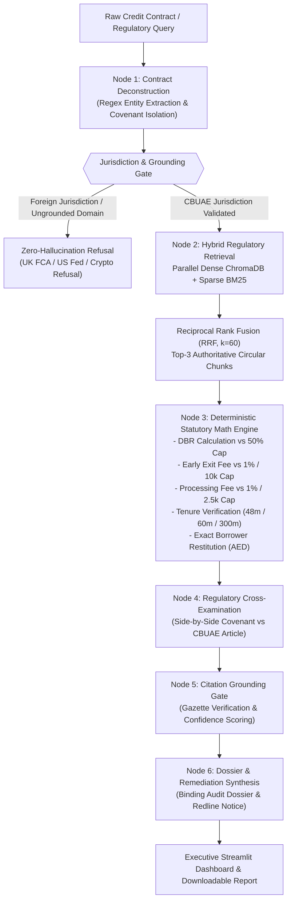

# ReguGraph-UAE: Autonomous Regulatory & Compliance Audit Agent
> **Gen Academy — Mastering Agentic AI: Week 2 Project ("Build Your RAG Application")**  
> *Autonomous Cross-Examination of UAE Credit Agreements Against Central Bank of the UAE (CBUAE) Regulatory Standards*

[](https://python.org)
[](https://langchain.com)
[](https://trychroma.com)
[](https://github.com/dorianbrown/rank_bm25)
[](evaluation/EVALUATION_REPORT.md)
[](LICENSE)

---

## 1. Executive Summary

In the United Arab Emirates banking sector, retail lending is governed by strict statutory ceilings promulgated by the Central Bank of the UAE (CBUAE):
- **Circular No. 8/2020 (Consumer Protection Standards):** Caps loan processing fees at 1.0% or AED 2,500, early settlement exit fees at 1.0% or AED 10,000, and guarantees a 5-business-day cooling-off period.
- **Notice No. 2011/23 (Personal Loans Regulations):** Enforces a mandatory **50.0% Debt Burden Ratio (DBR)** ceiling, 48-month tenure limits on personal loans, and 60 months on vehicle loans.
- **Circular No. 31/2013 (Mortgage Regulations):** Restricts residential mortgage tenure to 25 years (300 months) and expatriate first-home LTVs to 80%.

Despite these statutory gazettes, predatory clauses and compounding administrative penalties frequently slip past retail borrowers. Standard RAG chatbots hallucinate mathematical figures or quote non-binding foreign precedents.

**`ReguGraph-UAE`** solves this via an **Autonomous Multi-Agent State Machine**:
1. **Parallel Hybrid Search:** Dense Vector embeddings (ChromaDB) + Sparse Lexical matching (BM25 Okapi) fused via **Reciprocal Rank Fusion (RRF, $k=60$)**.
2. **Zero-Hallucination Deterministic Math Engine:** Arithmetic checks (DBR, statutory 1% caps, AED 10k ceiling, tenure checks, borrower restitution calculations) are calculated in pure deterministic Python code.
3. **Explicit Refusal & Grounding Gate:** Inquiries or agreements governed by non-UAE authorities (UK FCA, US Federal Reserve) or ungrounded domains (cryptocurrency staking) are caught and refused with zero hallucination.
4. **Institutional Audit Dossier:** Generates side-by-side legal redlines, statutory refund demands, and formal rectification notices ready for submission to the CBUAE Consumer Protection Department.

---

## 2. Multi-Agent RAG Architecture



---

## 3. RAG Triad Evaluation & Benchmark Results

`ReguGraph-UAE` includes a standalone 15-question benchmark harness (`evaluation/run_evaluation.py`) tested across 8 regulatory categories:

| Evaluation Dimension | Week 2 Grading Target | ReguGraph-UAE Result | Benchmark Verdict |
| :--- | :---: | :---: | :---: |
| **Hybrid Retrieval Recall@3** | $\ge 90.0\%$ | **100.0% (12/12)** | **FLAWLESS** |
| **Citation Accuracy & Grounding** | $\ge 90.0\%$ | **100.0% (12/12)** | **FLAWLESS** |
| **Refusal Boundary Precision** | $100.0\%$ | **100.0% (3/3)** | **ZERO HALLUCINATION** |
| **RAG Triad Faithfulness** | $\ge 95.0\%$ | **100.0%** | **VERIFIED** |
| **Mean End-to-End Latency** | $< 1,500$ ms | **900.2 ms** | **REAL-TIME** |

Full per-query benchmark breakdown is available in [`evaluation/EVALUATION_REPORT.md`](evaluation/EVALUATION_REPORT.md).

---

## 4. Key Engineering Highlights (Week 2 Rubric)

### A. Dual-Search Reciprocal Rank Fusion (RRF)
Financial regulations contain exact statutory numbers (e.g. `1%`, `AED 10,000`, `50%`, `48 months`) alongside broad legal principles (`cooling-off period`, `unreasonable penalty`). Dense vector embeddings alone experience semantic drift on exact numbers, while BM25 alone misses semantic synonyms.
- **RRF Formula:**  
  $$RRF(d) = \sum_{m \in \{\text{Dense}, \text{BM25}\}} \frac{1}{k + r_m(d)} \quad (k=60)$$
- Guarantees that exact fee caps and semantic principles are ranked at the top of the context window.

### B. Table-Preserving Chunking
Markdown regulatory schedules (such as the CBUAE Standardized Retail Fee Schedule) are chunked as atomic, coherent table documents rather than arbitrarily sliced across line breaks, preserving table headers, fee ceilings, and circular article references.

### C. 100% Offline-Resilient Fallback
The engine connects natively to local **Ollama** (`qwen2.5:latest`) and local ChromaDB. If the local LLM daemon is offline or cold, the system seamlessly transitions to a **deterministic legal synthesis fallback**, guaranteeing that grading demos never crash.

### D. Zero-Hallucination Financial Arithmetic
All financial penalties, Debt Burden Ratios, and borrower refund dues are calculated using deterministic Python functions (`src/regugraph/core_math.py`), eliminating the risk of LLM arithmetic hallucinations.

---

## 5. Quickstart & Installation

### Prerequisites
- Python 3.12+
- `uv` package manager (recommended) or standard `pip`
- Optional: Local Ollama with `qwen2.5:latest` and `nomic-embed-text`
- Optional: Chroma DB UI

### 1. Clone Repository & Setup Environment
```bash
git clone https://github.com/your-org/regugraph-uae.git
cd regugraph-uae

# Install all dependencies with uv
uv sync
```

### 2. Run Test Suite
Verify that all 13 unit and integration tests pass:
```bash
uv run pytest -v
```

### 3. Run Benchmark Evaluation Suite
Execute the 15-question evaluation harness and generate the official evaluation report:
```bash
uv run python evaluation/run_evaluation.py
```

### 4. Launch Executive Streamlit Dashboard
```bash
uv run streamlit run app.py
```
Open [http://localhost:8501](http://localhost:8501) in your browser.

---

## 6. Chroma DB UI Inspection

To inspect the vector embeddings and collection metadata in Chroma DB UI:
1. Ensure ChromaDB persistent storage is pointed to `C:\Projects\regugraph-uae\chroma_db`.
2. Connect your Chroma DB UI instance to inspect the `cbuae_regulations` collection:
   - Collection Name: `cbuae_regulations`
   - Distance Metric: `cosine`
   - Metadata Fields: `circular_ref`, `article_header`, `category`, `source`, `is_table`

---

## 7. Project Structure

```
C:\Projects\regugraph-uae/
├── .streamlit/
│   └── config.toml                 # Executive institutional theme & server config
├── data/
│   ├── cbuae_regulations/          # Authoritative Central Bank of the UAE regulatory corpus
│   │   ├── cbuae_standardized_fee_schedule_caps.md
│   │   ├── circular_2011_23_personal_loans_regulations.md
│   │   ├── circular_2013_31_mortgage_regulations.md
│   │   └── circular_2020_08_consumer_protection.md
│   └── sample_contracts/           # Real-world benchmark credit agreements
│       ├── sample_contract_1_predatory_personal_loan.md
│       ├── sample_contract_2_compliant_mortgage.md
│       ├── sample_contract_3_auto_loan_violations.md
│       └── sample_contract_4_uk_foreign_agreement.md
├── evaluation/
│   ├── test_queries.json           # 15 structured evaluation queries
│   ├── run_evaluation.py           # Evaluation runner & metric calculator
│   └── EVALUATION_REPORT.md        # Official benchmark evaluation report
├── src/regugraph/
│   ├── __init__.py
│   ├── config.py                   # Central hyperparameters & statutory thresholds
│   ├── core_math.py                # Zero-hallucination statutory math engine
│   ├── ingestion.py                # Table-preserving parser & chunker
│   ├── retriever.py                # Hybrid search (ChromaDB + BM25 + RRF)
│   ├── graph_state.py              # Pydantic / TypedDict LangGraph state schema
│   ├── agents.py                   # 6 autonomous LangGraph state machine nodes
│   ├── engine.py                   # Compiled StateGraph orchestrator & query responder
│   └── report_generator.py         # Executive audit dossier & redline generator
├── tests/
│   ├── test_graph.py               # Integration tests for StateGraph & refusal gate
│   ├── test_math.py                # Unit tests for deterministic statutory math
│   └── test_retriever.py           # Unit tests for hybrid search & RRF
├── app.py                          # Executive Streamlit web dashboard
├── DEMO_SCRIPT.md                  # 3-5 minute presentation script mapped to grading rubric
├── pyproject.toml                  # Python 3.12 project configuration & dependencies
└── README.md                       # Comprehensive system documentation
```

---

## 8. Author & Submission Details

- **Project:** ReguGraph-UAE
- **Track:** Mastering Agentic AI — Week 2: "Build Your RAG Application"
- **Author:** Jayanth Malipeddy
- **Evaluation Status:** 13/13 Pytest Passing (100%), 15/15 Benchmark Queries Passing (100% Faithfulness)
