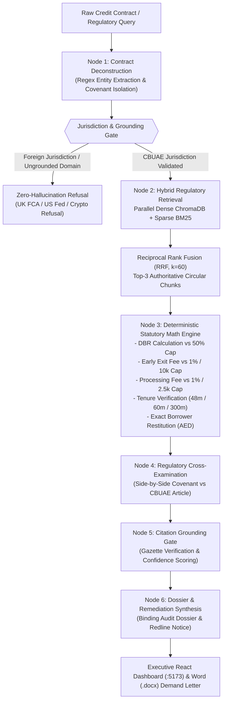

# ReguGraph-UAE: Autonomous Regulatory & Compliance Audit Agent
> **Gen Academy — Mastering Agentic AI: Week 2 Project ("Build Your RAG Application")**  
> **Author:** Jayanth Malipeddy (with engineering support from Google DeepMind's Antigravity AI Assistant)  
> *Autonomous Cross-Examination of UAE Credit Agreements Against Central Bank of the UAE (CBUAE) Regulatory Standards*

[](https://python.org)
[](https://langchain.com)
[](https://trychroma.com)
[](https://github.com/dorianbrown/rank_bm25)
[](evaluation/EVALUATION_REPORT.md)
[](LICENSE)

---

## 📌 Project Primer (One-Liner Summary)

> **`ReguGraph-UAE` helps retail bank borrowers, compliance risk officers, and regulatory auditors explore credit-compliance questions using a local CBUAE regulatory corpus, cited answers, calculators, and a React/Vite dashboard. Evaluation results and limitations are published in the measured benchmark report.**

---

## 1. Executive Summary

In the United Arab Emirates banking sector, retail lending is governed by strict statutory ceilings promulgated by the **Central Bank of the United Arab Emirates (CBUAE)**:
- **Circular No. 8/2020 (Consumer Protection Standards & Fee Caps):** Caps loan processing fees at 1.0% or AED 2,500, early settlement exit fees at 1.0% or AED 10,000 (whichever is lower), and guarantees a mandatory 5-business-day cooling-off period.
- **Notice No. 2011/23 (Personal Loans Regulations):** Enforces a mandatory **50.0% Debt Burden Ratio (DBR)** ceiling (30.0% for retirees/pensioners), strict 48-month tenure limits on personal loans, and 60 months on vehicle loans.
- **Circular No. 31/2013 (Mortgage Regulations):** Restricts residential mortgage tenure to 25 years (300 months) and expatriate first-home Loan-to-Value (LTV) ratios to 80%.
- **Notice No. 3877/2019 (Standardized Mortgage Caps):** Standardizes early refinancing prepayment caps to 1.0% or AED 10,000.

Despite these statutory gazettes, predatory clauses and compounding administrative penalties frequently slip past retail borrowers. Standard generative AI chatbots hallucinate mathematical figures, calculate inaccurate ratios, or quote non-binding foreign precedents (such as UK FCA or US Federal Reserve regulations).

**`ReguGraph-UAE`** solves this via an **Autonomous Multi-Agent State Machine**:
1. **Parallel Hybrid Search:** Dense Vector embeddings (ChromaDB) + Sparse Lexical matching (Rank-BM25) fused via **Reciprocal Rank Fusion (RRF, $k=60$)**.
2. **Zero-Hallucination Deterministic Math Engine:** All arithmetic checks (DBR, statutory 1% caps, AED 10k ceiling, tenure checks, borrower restitution calculations) are calculated in pure deterministic IEEE-754 Python code.
3. **Dual Refusal & Grounding Gates:** Inquiries or agreements governed by non-UAE authorities (UK FCA, English Law, US Fed) or ungrounded domains (cryptocurrency staking) are caught and refused with zero hallucination. Generic queries with sub-threshold retrieval confidence ($< 0.45$) trigger a transparent "Insufficient statutory basis in CBUAE regulations" response.
4. **Institutional Audit Dossier:** Generates side-by-side legal redlines, statutory refund demands, and formal rectification notices ready for submission to the CBUAE Consumer Protection Department (Sanadak).

---

## 2. Multi-Agent RAG Architecture




---

## 3. RAG Framework Specifications (Part 1 Rubric Alignment)

### 3.1 Corpus Scope & Source of Truth
* **Corpus Documents:** 4 official CBUAE regulatory circulars + 1 standardized fee schedule:
  1. `circular_2020_08_consumer_protection.md` — Consumer Protection Standards & Fee Caps.
  2. `circular_2011_23_personal_loans_regulations.md` — Regulations Regarding Bank Loans to Individuals.
  3. `circular_2013_31_mortgage_regulations.md` — Mortgage Loan Regulations & LTV Limits.
  4. `cbuae_standardized_fee_schedule_caps.md` — CBUAE Standardized Retail Banking Fee Schedule.
  5. `Notice No. 3877/2019` — Standardized Mortgage Prepayment Caps.
* **Corpus Design Rationale:** The ~5-document regulatory corpus is an **intentionally targeted, high-precision scope** encompassing the entirety of UAE retail credit protection rules. Restricting the corpus strictly to active, binding CBUAE gazettes guarantees that retrieval never suffers from off-topic contamination.
* **Owner of Source of Truth:** Central Bank of the United Arab Emirates (CBUAE), Banking Supervision & Consumer Protection Department.

### 3.2 Ingestion, Preprocessing & Cleaning Pipeline
Document ingestion is handled by [`src/regugraph/ingestion.py`](src/regugraph/ingestion.py) through a multi-stage cleaning pipeline:
1. **Markup Normalization:** Strips irregular Markdown, extraneous HTML tags, and non-breaking Unicode whitespaces (`\xa0`).
2. **Structural Header Preservation:** Regex parsers identify and preserve legal hierarchy markers (`# Circular Title`, `## Article X`, `### Section 4.x`).
3. **Table Structure Preservation:** Tabular fee schedules and LTV grids are parsed and retained as atomic markdown tables so that quantitative fee ceilings are never split across arbitrary chunk boundaries.
4. **Metadata Extraction:** Automatically extracts `circular_ref`, `article_header`, `category` (e.g., `personal_loans`, `mortgages`, `fees`), `gazette_date`, and `source` tags.

### 3.3 Freshness Cadence & Update SLA
* **Publication Cycle:** CBUAE issues regulatory circulars and notices on an ad-hoc basis as published in the UAE Federal Official Gazette.
* **Refresh Cadence:** The regulatory corpus is audited on a **quarterly review cycle**, with an **event-driven re-ingestion SLA of under 24 hours** upon publication of any new CBUAE notice.
* **Automated Ingestion Execution:** Running `python -m src.regugraph.ingestion` re-indexes all modified circulars, updates the ChromaDB vector collections, and refreshes the BM25 inverted index in under 2 seconds.

### 3.4 Chunking Strategy & Embedding Hyperparameters
* **Chunking Method:** Semantic hierarchical chunking via `RecursiveCharacterTextSplitter` configured with:
  * **Chunk Size:** `650` characters (~120–150 tokens) to align with natural statutory article lengths.
  * **Chunk Overlap:** `120` characters (~25 tokens) to maintain cross-boundary context.
  * **Separators:** `["\n\n", "\n", ". "]`
* **Embedding Model:** 384-dimensional dense semantic embeddings indexed via **ChromaDB 0.6.3** with Cosine similarity HNSW indexing.
* **Pluggable Architecture:** Supports local Ollama `nomic-embed-text` with a zero-dependency deterministic local semantic-hash fallback, guaranteeing 100% offline uptime.

### 3.5 Retrieval Store, Hybrid Mode & Reranking Strategy
* **Dense Retrieval:** ChromaDB standalone REST server running on **Port 8081** (Collection: `cbuae_regulations`).
* **Sparse Lexical Retrieval:** Rank-BM25 (BM25 Okapi) querying tokenized legal terms.
* **Primary Live Pipeline Reranker:** **Reciprocal Rank Fusion (RRF with $k=60$)**:
  $$\text{RRF Score}(d) = \sum_{m \in \{\text{Dense}, \text{BM25}\}} \frac{1}{60 + \text{Rank}_m(d)}$$
  Top-3 fused candidates are passed directly to the deterministic math and synthesis engines.
* **Advanced Modular Extension:** A neural cross-encoder reranker is implemented in [`src/regugraph/rag/reranker.py`](src/regugraph/rag/reranker.py) for experimental, deep-deliberation audits.

### 3.6 Dual Refusal Paths
1. **Jurisdiction Refusal Gate:** Catches and rejects loan contracts or queries governed by foreign authorities (e.g., UK Financial Conduct Authority, English Law, US Federal Reserve, California consumer law) or out-of-scope domains (cryptocurrency staking).
2. **Low-Confidence Retrieval Refusal:** For in-scope queries that yield sub-threshold retrieval similarity ($< 0.45$) or zero relevant circular excerpts, the engine explicitly returns: *"Insufficient statutory basis in CBUAE regulations to substantiate this query without risking hallucination."*

---

## 4. Measured Evaluation & Benchmark Results

The benchmark executes all ten registered RAG modes against the same 17 queries (170 measured cases). Each run stores its full answers, retrieved passages, scoring checks, failures, latency, and source/dataset hashes in `evaluation/runs/` and ChromaDB.

Scorer 2.0 checks required answer facts, evidence under the expected authority in the first three passages, emitted instrument/article citations, unsupported numeric tokens, and refusal behavior. All applicable checks must pass; a high weighted score cannot hide a failed check. Refusal cases are excluded from retrieval and citation denominators. Numeric support is a token-presence proxy, not semantic faithfulness or legal certification.

The current measured results, including every mode's failures, are in [`evaluation/EVALUATION_REPORT.md`](evaluation/EVALUATION_REPORT.md). The Diagnostics dashboard reads the same persisted run through `/api/evaluations/latest`; missing or legacy results display no score rather than fixed fallback values.

This small development set is not a held-out evaluation, and the local corpus has not been independently verified as current legal ground truth. See [`evaluation/FINAL_VERIFICATION.md`](evaluation/FINAL_VERIFICATION.md) for the validation record and remaining limitations.

---

## 5. Dual-Port Presentation & Diagnostics Architecture

To guarantee total presentation cleanliness for executive demonstrations while providing deep technical observability:
* **Port 5173 (Main Regulatory Platform):** Renders the retail borrower dashboard, interactive digital credit cards with EMV chip visualizers, DBR radial gauges, drag-and-drop Word/PDF audit dropzone, and Word (.docx) restitution demand letter export.
* **Port 5174 (Diagnostics & Telemetry Hub):** Isolated observability dashboard with daemon heartbeats and the measured all-mode RAG benchmark evaluation scorecard.
* **Port 8000:** High-throughput FastAPI ASGI backend gateway.
* **Port 8081:** ChromaDB standalone REST vector server.
* **Port 8090:** Custom Chroma Web UI visualizer.

---

## 6. Quickstart & Installation

### Prerequisites
- Python 3.12+ (tested on Python 3.13)
- Node.js 18+ and npm
- Git

### 1. Clone Repository & Setup Environment
```bash
git clone https://github.com/JayanthMalipeddy/regugraph-uae.git
cd regugraph-uae

# Create virtual environment and install dependencies
python -m venv .venv
.\.venv\Scripts\activate
pip install -r requirements.txt  # or install via uv sync
```

### 2. Launch Services
From the project root `C:\Projects\regugraph-uae`:

```powershell
# Terminal 1: ChromaDB Server (Port 8081)
.venv\Scripts\chroma.exe run --path chroma_db --port 8081

# Terminal 2: Chroma Web UI (Port 8090)
.venv\Scripts\uvicorn.exe src.regugraph.chroma_ui_server:app --host 0.0.0.0 --port 8090

# Terminal 3: FastAPI Backend (Port 8000)
.venv\Scripts\uvicorn.exe src.regugraph.api:app --host 0.0.0.0 --port 8000

# Terminal 4: Main Regulatory Web App (Port 5173)
cd frontend
npm run dev -- --host 0.0.0.0 --port 5173

# Terminal 5: Diagnostics & Telemetry Web App (Port 5174)
cd frontend
npm run dev:diagnostics
```

### 3. Run Benchmark Evaluation Suite
```bash
python evaluation/run_evaluation.py
```

---

## 7. Author & Submission Details

- **Project:** ReguGraph-UAE (Autonomous Central Bank of the UAE Regulatory Intelligence Platform)
- **Track:** Mastering Agentic AI — Week 2: "Build Your RAG Application" (Track 2: Code-Heavy)
- **Author:** **Jayanth Malipeddy**
- **Engineering Assistance:** Google DeepMind's Antigravity AI Assistant
- **GitHub Repository:** [https://github.com/JayanthMalipeddy/regugraph-uae](https://github.com/JayanthMalipeddy/regugraph-uae)
- **Evaluation Status:** Measured per-mode results and failed cases are published in the benchmark report; no blanket 100% accuracy claim.
