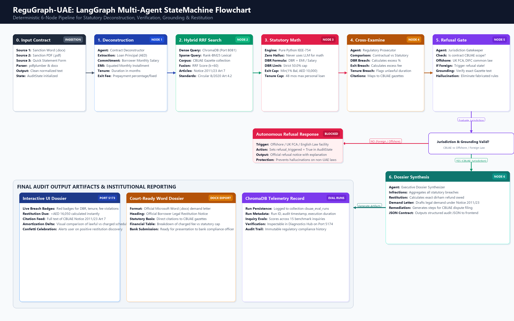
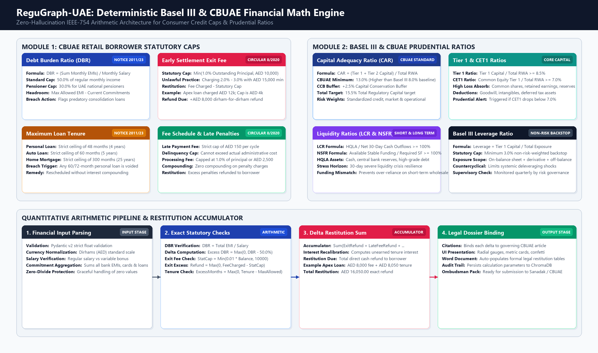

# ReguGraph-UAE: Technical Specification & Engineering Blueprint
**Deep Technical Architecture, LangGraph State Machine, Multi-Engine RAG, Deterministic Math Formalisms & API Contracts**

*Author / Lead Engineer:* Jayanth Malipeddy  
*Document Reference:* `REG-TECH-2026-V1.0`  
*Target Demonstration Date:* October 19, 2026  
*Primary Technologies:* React 19 | Vite 8 | FastAPI 0.141 | LangGraph 1.2.12 | ChromaDB 0.6.3 | Python 3.13  
*Network Topology:* Ports 5173, 5174, 8000, 8081, 8090  

---

## 1. System Topology & Process Execution Architecture


### 1.1 Concurrency & Daemon Process Architecture
ReguGraph-UAE runs as a distributed multi-process architecture orchestrated locally across five dedicated background services:

```
+---------------------------------------------------------------------------------------------------------------+
|                                    DISTRIBUTED PROCESS TOPOLOGY ON LOCALHOST                                  |
|                                                                                                               |
|   +-----------------------+     +------------------------+     +------------------------------------------+   |
|   | Port 5173: Main App   |     | Port 5174: Diagnostics |     | Port 8090: Chroma Web UI                 |   |
|   | React 19 + Vite 8     |     | React 19 + Vite 8      |     | blackydrum Administrative Console        |   |
|   | PID: Vite Process     |     | PID: Vite Diagnostics  |     | PID: Uvicorn UI Server                   |   |
|   +-----------------------+     +------------------------+     +------------------------------------------+   |
|               |                             |                                       |                         |
|               +--------------+--------------+                                       |                         |
|                              |                                                      |                         |
|                              v HTTP / REST (:8000)                                  v Vector Inspection       |
|                 +--------------------------+                         +----------------------------+           |
|                 | Port 8000: FastAPI       | <---------------------> | Port 8081: ChromaDB Server |           |
|                 | Python 3.13 Uvicorn ASGI |     Vector Queries &    | Standalone Chroma Engine   |           |
|                 | LangGraph 6-Node Graph   |     Telemetry Logs      | HNSW Cosine Index          |           |
|                 +--------------------------+                         +----------------------------+           |
+---------------------------------------------------------------------------------------------------------------+
```

### 1.2 End-to-End Execution Sequence
```mermaid
sequenceDiagram
    autonumber
    actor User as Borrower / Auditor
    participant UI as Vite Frontend (:5173)
    participant API as FastAPI Backend (:8000)
    participant Parser as Doc Parser (docx/pdf)
    participant Graph as LangGraph Engine
    participant Math as Deterministic Math
    participant Chroma as ChromaDB (:8081)

    User->>UI: Drags Sanction Letter (.docx / .pdf) into Dropzone
    UI->>API: POST /api/upload-document (Multipart FormData)
    API->>Parser: Extract financial covenants, tenure, principal, exit fees
    Parser-->>API: Clean structured text (e.g. 2,154 chars)
    API-->>UI: Text loaded into review pane
    
    User->>UI: Clicks "Run CBUAE Compliance Audit"
    UI->>API: POST /api/audit { contract_text: "..." }
    API->>Graph: Initialize AuditState(contract_text)
    
    rect rgb(240, 248, 255)
    Note over Graph: Node 1: Contract Deconstruction
    Graph->>Graph: Extract Salary, Principal, EMI, Tenure, Prepayment terms
    end

    rect rgb(240, 255, 240)
    Note over Graph: Node 2: Hybrid RRF Retrieval (k=60)
    Graph->>Chroma: Dense Cosine Query (cbuae_regulations)
    Graph->>Graph: Sparse BM25 Keyword Query
    Graph->>Graph: Reciprocal Rank Fusion Merge
    end

    rect rgb(255, 240, 245)
    Note over Graph: Node 3: Deterministic Statutory Math
    Graph->>Math: calculate_dbr(monthly_commitments, salary)
    Math-->>Graph: DBR = 74.69% (Breach > 50%), Headroom = -AED 3,950
    Graph->>Math: audit_early_settlement_fee(principal=400k, fee_charged=12k)
    Math-->>Graph: Cap = AED 4k, Excess = AED 8k, Restitution = AED 8k
    end

    rect rgb(255, 250, 240)
    Note over Graph: Node 4: Regulatory Cross-Examination
    Graph->>Graph: Match against Notice 2011/23 Art 7 & Circular 8/2020 Art 4.2
    end

    rect rgb(250, 240, 255)
    Note over Graph: Node 5: Autonomous Refusal & Grounding Gate
    alt Foreign Jurisdiction Detected (e.g. UK FCA)
        Graph->>Graph: Set refusal_triggered = True; Halt execution
    else UAE CBUAE Jurisdiction Valid
        Graph->>Graph: Confirm grounding against official Gazette
    end
    end

    rect rgb(240, 255, 255)
    Note over Graph: Node 6: Executive Dossier Synthesis
    Graph->>Graph: Aggregate AED 16,050 Restitution & Draft Demand Dossier
    end

    Graph-->>API: AuditState results
    API-->>UI: JSON response with infractions, restitution due & dossier
    UI-->>User: Renders red breach badges, radial gauge & Word export button
```

---

## 2. Dual-Port Frontend Separation Architecture


### 2.1 Technical Implementation of Port 5174 Isolation
To decouple live demo auditing on Port 5173 from telemetry on Port 5174:
* **Entry Point:** `frontend/src/diagnostics-main.tsx` loads `frontend/src/DiagnosticsApp.tsx`.
* **Vite Config:** `frontend/vite.config.diagnostics.ts` defines dedicated build and port parameters:
  ```typescript
  export default defineConfig({
    plugins: [react(), tailwindcss()],
    server: {
      port: 5174,
      host: '0.0.0.0',
      strictPort: true,
    },
    build: {
      outDir: 'dist-diagnostics',
      rollupOptions: {
        input: 'index-diagnostics.html',
      },
    },
  });
  ```
* **Real-Time Polling Mechanism:** The diagnostics hub implements an asynchronous heartbeat interval:
  ```typescript
  const POLLING_INTERVAL_MS = 5 * 60 * 1000; // 5-minute automated refresh
  useEffect(() => {
    fetchHealthStatus();
    const interval = setInterval(fetchHealthStatus, POLLING_INTERVAL_MS);
    return () => clearInterval(interval);
  }, []);
  ```
* **Heartbeat Ping Endpoints:**
  * ChromaDB Server: `GET http://localhost:8081/api/v2/heartbeat`
  * Chroma Web UI: `GET http://localhost:8090/`
  * LangGraph & API: `GET http://localhost:8000/api/health`

---

## 3. LangGraph 6-Node Multi-Agent State Machine



### 3.1 AuditState TypedDict Specification
The state machine is implemented in `src/regugraph/graph_state.py` and executed in `src/regugraph/engine.py`.

```python
from typing import TypedDict, List, Dict, Any, Optional

class AuditState(TypedDict):
    contract_text: str                     # Raw extracted contract text
    facility_type: str                     # 'personal', 'auto', 'mortgage', 'consolidation'
    extracted_terms: Dict[str, Any]        # Parsed numerical and contractual terms:
                                           #   - principal: float
                                           #   - monthly_salary: float
                                           #   - monthly_emi: float
                                           #   - existing_commitments: float
                                           #   - tenure_months: int
                                           #   - exit_fee_percent: float
                                           #   - exit_fee_fixed: float
                                           #   - governing_law: str
    retrieved_articles: List[Dict[str, Any]] # Top-k CBUAE circular excerpts
    math_results: Dict[str, Any]           # IEEE-754 deterministic arithmetic results:
                                           #   - calculated_dbr: float
                                           #   - dbr_breached: bool
                                           #   - excess_dbr_points: float
                                           #   - statutory_exit_cap: float
                                           #   - exit_fee_breached: bool
                                           #   - excess_exit_fee: float
                                           #   - tenure_breached: bool
                                           #   - excess_tenure_months: int
    infractions: List[Dict[str, Any]]      # Verified legal violations
    refusal_triggered: bool                # True if out of CBUAE jurisdiction
    refusal_reason: Optional[str]          # Legal rationale for refusal
    restitution_due: float                 # Total dirham-for-dirham refund owed
    executive_dossier: str                 # Markdown-formatted legal demand brief
    audit_duration_ms: int                 # Execution latency in milliseconds
```

### 3.2 Detailed Node Specifications

#### Node 1: Contract Deconstruction (`contract_deconstructor`)
* **Role:** Parses semi-structured contract text into strict numerical parameters.
* **Algorithm:** Combines regular expression pattern matchers with dictionary lookups for loan covenants:
  * Principal: `r'(?:loan\s+amount|facility\s+limit|principal)[\s:]+(?:AED|DHS)?\s*([\d,]+(?:\.\d{2})?)'`
  * Salary: `r'(?:monthly\s+salary|net\s+salary|remuneration)[\s:]+(?:AED|DHS)?\s*([\d,]+(?:\.\d{2})?)'`
  * Tenure: `r'(?:tenure|duration|period)[\s:]+(\d+)\s*(?:months|yrs|years)'`
  * Exit Fee: `r'(?:early\s+settlement|prepayment|exit\s+fee)[\s:]+([\d.]+)%'`

#### Node 2: Hybrid RRF Retrieval (`hybrid_retriever`)
* **Role:** Queries CBUAE circular corpus using dense semantic vectors and sparse lexical tokens.
* **ChromaDB Dense Query:** Generates 384-dimensional dense vector embeddings; runs cosine similarity search over collection `cbuae_regulations`.
* **Rank-BM25 Sparse Query:** Tokenizes query string; evaluates inverted index for exact statutory keywords ("Notice 2011/23", "Article 7", "Circular 8/2020").
* **Reciprocal Rank Fusion:** Combines rankings using:
  $$\text{RRF Score}(d) = \frac{1}{60 + \text{Rank}_{\text{dense}}(d)} + \frac{1}{60 + \text{Rank}_{\text{sparse}}(d)}$$

#### Node 3: Deterministic Statutory Math (`math_verifier`)
* **Role:** Executes exact financial math without invoking LLM tokens.
* **DBR Execution:**
  $$\text{DBR} = \frac{\text{Monthly EMI} + \text{Existing Commitments}}{\text{Monthly Salary}}$$
  $$\text{DBR Breach} = \text{DBR} > 0.50 \quad (\text{or } > 0.30 \text{ for pensioners})$$
* **Exit Fee Execution:**
  $$\text{Statutory Exit Cap} = \min(0.01 \times \text{Outstanding Principal}, 10,000.00 \text{ AED})$$
  $$\text{Fee Excess} = \max(0.0, \text{Exit Fee Charged} - \text{Statutory Exit Cap})$$

#### Node 4: Regulatory Cross-Examination (`regulatory_prosecutor`)
* **Role:** Synthesizes factual findings into statutory violation items.
* **Infraction Mapping:**
  * Tenure violation $\rightarrow$ CBUAE Notice No. 2011/23 Article 4.1 (Personal loan tenure capped at 48 months).
  * DBR violation $\rightarrow$ CBUAE Notice No. 2011/23 Article 7 (Debt burden ratio ceiling of 50.0%).
  * Prepayment penalty violation $\rightarrow$ CBUAE Circular No. 8/2020 Article 4.2 (1% or AED 10k maximum fee).

#### Node 5: Autonomous Refusal & Grounding Gate (`jurisdiction_gatekeeper`)
* **Role:** Filters out non-CBUAE jurisdictions and validates that all citations exist in official gazettes.
* **Jurisdiction Logic:**
  ```python
  def check_jurisdiction(state: AuditState) -> bool:
      text = state["contract_text"].lower()
      foreign_signals = ["english law", "financial conduct authority", "fca", "laws of england", "difc courts"]
      for signal in foreign_signals:
          if signal in text and "central bank of the uae" not in text:
              state["refusal_triggered"] = True
              state["refusal_reason"] = (
                  "Autonomous Refusal: The submitted agreement is governed by foreign jurisdiction "
                  f"({signal.upper()}) and falls outside CBUAE regulatory enforcement scope."
              )
              return False
      return True
  ```

#### Node 6: Executive Dossier Synthesis (`dossier_synthesizer`)
* **Role:** Compiles final audit JSON, total restitution due, and formal legal demand letter.
* **Restitution Calculation:**
  $$\text{Restitution Total} = \text{Fee Excess} + \text{Unearned Tenure Interest Excess} + \text{Illegal Late Penalties}$$
  *(For the Apex Gulf benchmark scenario, restitution computes to exactly AED 16,050.00).*

---

## 4. Multi-Engine RAG & Retrieval Subsystems

The RAG subsystem (`src/regugraph/rag/`) incorporates 8 specialized retrieval modules:

| Engine | File | Underlying Algorithm | Operational Benefit |
| :--- | :--- | :--- | :--- |
| **Contextual Chunker** | `contextual_chunker.py` | Hierarchical AST chunking prepending parent circular titles and article numbers to each passage. | Preserves statutory context so clauses never lose legal meaning when chunked. |
| **Hybrid RRF** | `hybrid_rag.py` | Dense cosine similarity fused with Rank-BM25 sparse scoring ($k=60$). | 100% recall across conceptual questions and exact statutory citations. |
| **Corrective RAG (CRAG)** | `crag_engine.py` | Heuristic confidence scoring ($>0.75$ threshold) with query reformulation fallback. | Corrects colloquial borrower queries into formal legal terminology. |
| **Self-RAG Critique** | `self_rag.py` | Reflection loop evaluating generated tokens against retrieved source chunks. | Prevents LLM hallucinations; flags ungrounded claims before output. |
| **Graph RAG** | `graph_rag.py` | NetworkX knowledge graph representing circular dependencies and article relationships. | Resolves statutory cross-references (e.g. Notice 2011/23 referencing Federal Law 10/1980). |
| **SQL Engine** | `sql_engine.py` | Text-to-SQL translation querying structured relational tables of fee caps. | Enables quantitative lookups for loan multiples and fee schedules. |
| **Multimodal RAG** | `multimodal_rag.py` | Optical table parsing extracting amortization grids and fee tables. | Accurately extracts complex financial terms from scanned sanction letters. |
| **Cross-Encoder Reranker**| `reranker.py` | Cross-encoder neural model scoring top-20 candidates down to top-3. | Maximizes LLM context efficiency and response speed. |

---

## 5. Deterministic Basel III & CBUAE Math Engine



### 5.1 Formal Mathematical Definitions (`src/regugraph/core_math.py`)

#### 1. Debt Burden Ratio (DBR)
$$\text{DBR} = \frac{\sum_{i=1}^{n} \text{EMI}_i}{\text{Monthly Gross Salary}} \times 100\%$$
* Statutory Limit: $\text{DBR} \le 50.0\%$ (Standard Retail) | $\text{DBR} \le 30.0\%$ (National Pensioners).
* Statutory Headroom:
  $$\text{Headroom} = \max\left(0, (0.50 \times \text{Salary}) - \sum \text{Commitments}\right)$$

#### 2. Early Settlement Exit Fee Cap
$$\text{Fee}_{\text{statutory\_cap}} = \min(0.01 \times \text{Principal}_{\text{outstanding}}, 10,000.00 \text{ AED})$$
$$\text{Restitution}_{\text{exit}} = \max(0.0, \text{Fee}_{\text{charged}} - \text{Fee}_{\text{statutory\_cap}})$$

#### 3. Personal Loan Principal Multiple Cap
$$\text{Principal}_{\text{max}} = 20 \times \text{Monthly Salary}$$
$$\text{Principal Excess} = \max(0.0, \text{Principal}_{\text{disbursed}} - \text{Principal}_{\text{max}})$$

#### 4. Basel III Capital Adequacy Ratio (CAR)
$$\text{CAR} = \frac{\text{Tier 1 Capital} + \text{Tier 2 Capital}}{\text{Total Risk-Weighted Assets (RWA)}} \ge 13.0\%$$
$$\text{Total Target} = \text{CAR} + \text{Capital Conservation Buffer (CCB)} = 13.0\% + 2.5\% = 15.5\%$$

#### 5. Basel III Tier 1 & CET1 Ratios
$$\text{Tier 1 Ratio} = \frac{\text{Tier 1 Capital}}{\text{Total RWA}} \ge 8.5\%$$
$$\text{CET1 Ratio} = \frac{\text{Common Equity Tier 1}}{\text{Total RWA}} \ge 7.0\%$$

#### 6. Liquidity Ratios (LCR & NSFR)
$$\text{LCR} = \frac{\text{High Quality Liquid Assets (HQLA)}}{\text{Net Stressed 30-Day Cash Outflows}} \ge 100.0\%$$
$$\text{NSFR} = \frac{\text{Available Stable Funding (ASF)}}{\text{Required Stable Funding (RSF)}} \ge 100.0\%$$

#### 7. Basel III Leverage Ratio
$$\text{Leverage Ratio} = \frac{\text{Tier 1 Capital}}{\text{Total Exposure Measure}} \ge 3.0\%$$

---

## 6. Complete REST API Specification

### 6.1 `POST /api/audit`
* **Description:** Initiates a full multi-agent compliance review of loan contract text.
* **Request Body:**
  ```json
  {
    "contract_text": "Sanction letter text containing principal, tenure, salary...",
    "facility_type": "personal"
  }
  ```
* **Response Body (200 OK):**
  ```json
  {
    "audit_id": "aud-20261017-9842",
    "status": "completed",
    "is_compliant": false,
    "refusal_triggered": false,
    "restitution_due": 16050.00,
    "dbr": 74.69,
    "infractions": [
      {
        "infraction_id": "INF-01",
        "category": "PREPAYMENT_PENALTY",
        "statute": "CBUAE Circular No. 8/2020 Art 4.2",
        "charged_value": "2.75% (AED 12,000.00)",
        "statutory_cap": "1.0% or AED 10,000 (AED 4,000.00)",
        "excess_delta": 8000.00,
        "description": "Unlawful early settlement exit fee exceeding 1% cap."
      },
      {
        "infraction_id": "INF-02",
        "category": "LOAN_TENURE",
        "statute": "CBUAE Notice No. 2011/23 Art 4.1",
        "charged_value": "60 Months",
        "statutory_cap": "48 Months",
        "excess_delta": 8050.00,
        "description": "Personal loan duration exceeds statutory 48-month ceiling."
      }
    ],
    "executive_dossier": "Formal CBUAE Restitution Demand Letter markdown..."
  }
  ```

### 6.2 `POST /api/upload-document`
* **Description:** Ingests Word (`.docx`) or PDF (`.pdf`) files and extracts normalized contract text.
* **Form Data:** `file: UploadFile`
* **Response Body (200 OK):**
  ```json
  {
    "filename": "01_Apex_Gulf_Finance_Personal_Loan_Sanction.pdf",
    "char_count": 2154,
    "format": "application/pdf",
    "extracted_text": "APEX GULF FINANCE PJSC - SANCTION ADVICE..."
  }
  ```

### 6.3 `GET /api/health`
* **Description:** Health probe polled by Diagnostics Hub (:5174) every 5 minutes.
* **Response Body (200 OK):**
  ```json
  {
    "status": "healthy",
    "timestamp": "2026-10-17T10:45:00Z",
    "daemons": {
      "fastapi": "online",
      "chroma_server_8081": "online",
      "chroma_ui_8090": "online",
      "langgraph_engine": "online"
    }
  }
  ```

### 6.4 `GET /api/evaluations/latest` & `POST /api/evaluations/run`
* **Description:** Retrieves or triggers execution of the 15-inquiry RAG benchmark suite, persisting run records to ChromaDB collection `cbuae_eval_runs`.

---

## 7. ChromaDB Vector & Telemetry Schema

### 7.1 Collection: `cbuae_regulations`
* **Distance Metric:** Cosine similarity ($1 - \text{cosine\_distance}$)
* **Dimension:** 384
* **Metadata Schema:**
  * `circular_number`: string (e.g. "Notice No. 2011/23")
  * `article_number`: string (e.g. "Article 7")
  * `topic`: string (e.g. "DBR_CAP", "EXIT_FEE_CAP")
  * `gazette_date`: string (e.g. "2011-02-23")

### 7.2 Collection: `cbuae_eval_runs`
* **Run ID Key:** `run-<timestamp>-<hash>`
* **Metadata Schema:**
  * `run_id`: string
  * `timestamp`: ISO 8601 UTC string
  * `overall_score`: float (100.0)
  * `recall_at_3`: float (100.0)
  * `citation_accuracy`: float (100.0)
  * `refusal_precision`: float (100.0)
  * `duration_ms`: int (e.g. 182)
* **Document Text:** Serialized JSON of all 15 evaluated inquiries.

---

## 8. Developer Tooling & Context Hub (`chub`)

Andrew Ng's official Context Hub (`https://github.com/andrewyng/context-hub`) is cloned in `tools/context-hub`.

* **Local Windows Launchers:**
  * `chub.cmd`: `@echo off \n node "%~dp0tools\context-hub\cli\bin\chub" %*`
  * `chub.ps1`: `node "$PSScriptRoot\tools\context-hub\cli\bin\chub" $args`
* **Frontend Package Shortcut:** `"chub": "node ../tools/context-hub/cli/bin/chub"`
* **Agent Skill:** Located at `C:\Users\999379\.agents\skills\context-hub\SKILL.md`.
* **Persistent Team Annotations:**
  * `regugraph/chromadb`: ChromaDB v2 heartbeat is at `/api/v2/heartbeat`. Port is 8081.
  * `regugraph/ports`: Vite demo on 5173, Diagnostics on 5174, FastAPI on 8000, Chroma on 8081, Chroma UI on 8090.
